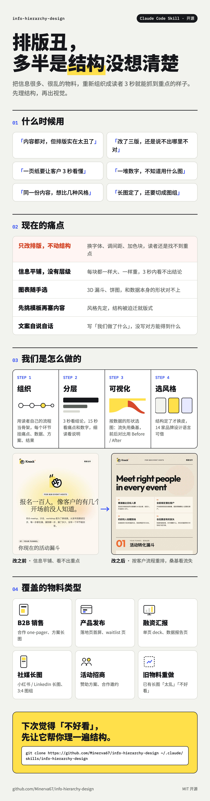

# info-hierarchy-design

**把一张「信息很多但很乱」的物料，变成读者 3 秒就能抓到重点的物料。**
A Claude Code skill for structuring outward-facing materials: information architecture → hierarchy → visualization → style.

核心只有一句话：**先按读者自己的流程组织信息，再定层级，再给每块选可视化，最后才选风格。顺序不能反。**



## 什么时候用

| 场景 | 典型物料 |
|---|---|
| B2B 销售 / BD | 合作 one-pager、方案长图、给客户的一页纸 |
| 产品发布 | 落地页首屏、功能介绍、waitlist 页 |
| 融资 / 汇报 | 单页 deck、提案页、数据报告页 |
| 社媒内容 | 小红书 / LinkedIn 长图、3:4 图组 |
| 活动 / 社区 | 招商、赞助方案、活动复盘 |
| 重新设计 | 已有物料「太乱」「不好看」 |

在 Claude Code 里直接说「这个排版太丑了帮我优化」「帮我做一张给客户看的一页纸」「信息层级怎么排」「出几个风格看看」，skill 会自动触发。

## 它怎么工作

1. **先写三行**：给谁看、看完做什么、对方关心什么结果。
2. **用读者自己的流程当骨架**：每个环节挂「痛点 → 数据 → 方案 → 结果」，找出共同的根因。
3. **三层信息层级**：3 秒看结论，15 秒看痛点和数字，细读看说明；全页只用一处强调色。
4. **按数据的形状选可视化**：逐级流失用连接条形图或桑基图，现状到结果用 Before / After，洞察用场景示意图。
5. **结构定了再选风格**：同一份内容换皮比较，14 家品牌设计语言可借。
6. **文案口径**：平实书面、只写读者得到什么、数字诚实、姿态对等、不写承诺。
7. **渲染自检**：出图后检查断行、溢出和大块空白。

## 里面有什么

```
SKILL.md                      完整流程 + 反模式清单
references/
  viz-patterns.md             6 种可视化的实现要点
  brand-styles/               14 家品牌设计语言（README + tokens.json）
```

## 安装

```bash
git clone https://github.com/Minerva67/info-hierarchy-design ~/.claude/skills/info-hierarchy-design
```

## 致谢与授权

- `references/brand-styles/` 整理自 [VoltAgent/awesome-design-md](https://github.com/VoltAgent/awesome-design-md)（MIT）。这些是非官方风格参考，不含任何品牌 logo，只用于学习设计语言，请勿冒用品牌。
- 示例中的行业基准数字均标注来源；示例品牌 YourBrand 为虚构。

MIT License
